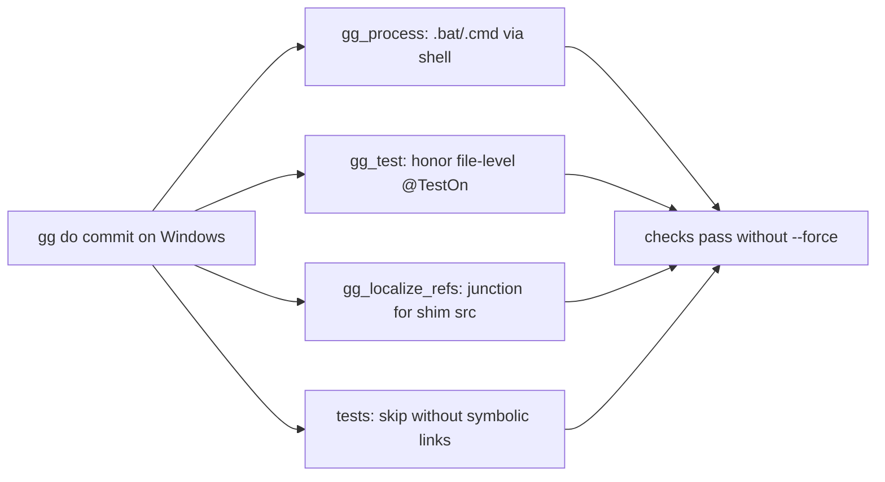

<!--
@license
Copyright (c) ggsuite

Use of this source code is governed by terms that can be
found in the LICENSE file in the root of this package.
-->

# Make gg checks work on Windows

## Motivation

- gg checks, commits and pushes code on Windows as on macOS and Linux
- In ticket 38 of the audaudio workspace, the checks failed on Windows
- The failures came from gg itself, not from the code under test
- Ticket gg-1 removes these causes, so a Windows developer needs neither
  `--force` nor Developer Mode to get through `gg do commit`

## Strategy

- Fix each failure where it starts, in the package of the suite that owns it
- Start commands the Flutter SDK ships as `.bat` or `.cmd` through the shell
- Skip checks and tests that the platform cannot run, instead of failing
- Prefer Windows means that need no extra rights, like directory junctions
- Let tests that need symbolic links skip where none can be created
- Verify the result end to end on the repos of audaudio ticket 38

## Implementation 1: Changes across the suite

- `gg_process` starts commands the PATH holds only as `.bat` or `.cmd`,
  like `flutter` and the `dart` of the Flutter SDK, through the shell
- `gg_test` no longer demands coverage for implementation files whose test
  file excludes the platform with a file-level `@TestOn`
- `gg_localize_refs` creates the `src` link of the TypeScript shim as a
  directory junction on Windows, so no Developer Mode is needed
- `gg_multi_core` and `gg_multi_workspace` skip tests whose subject is a
  symbolic link where none can be created
- `gg do add --no-fetch` now copies ocean repos as they are, as its help says

## Implementation 2: Host tests without symbolic links

- New `test/symlinks.dart` provides `canCreateSymlinks` and
  `skipWithoutSymlinks`
- Three conformance tests in `test/host/dart_io_conformance.dart` skip
  without symbolic links:
  - creates, reads and deletes a symbolic link
  - creates a link recursively and asynchronously
  - compares identity through resolved links
- The link members of `GgHostLink` in `gg_host_io_overrides.dart` are
  coverage-ignored
- The link branches of `GgHostIo` (delete, `createLink`, `linkTarget`) are
  coverage-ignored as well
- Windows tests reach this code in Developer Mode only, so coverage would
  otherwise fail on a plain Windows machine

## Implementation 3: Install for testing

- `install.bat` activates gg from the ticket folder
- This lets the fixed gg run against other workspaces before it is published

## Result

- With the gg of this ticket, all repos of audaudio ticket 38 were
  committed and pushed on Windows without `--force`

## Open Points

- Link code in the host layer is covered on macOS and Linux only; Windows
  covers it only with Developer Mode enabled
- The fixes in the other packages of the suite are released with their own
  versions; gg picks them up through its dependencies
